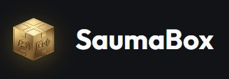
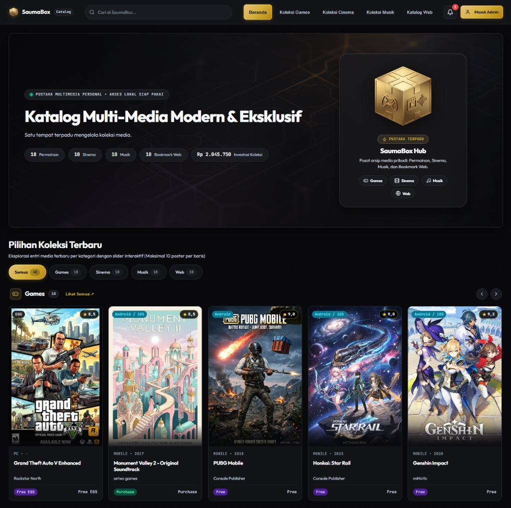

<p align="center">
  
</p>

<p align="center">
  Aplikasi katalog multimedia mandiri untuk mengelola koleksi game, sinema, dan musik pribadi tanpa ketergantungan layanan cloud.
</p>

<p align="center">
  <a href="https://github.com/ZhangNX221/SaumaBox/releases/tag/v0.5.3"></a>
  <a href="https://nodejs.org/"></a>
  <a href="https://sqlite.org/"></a>
  <a href="LICENSE"></a>
</p>

<p align="center">
  
</p>

---

## Yang Bisa Dilakukan SaumaBox

- **Koleksi Game**: Catat game PC, emulator retro (PS2, PSP, Wii U, Switch), dan recompilation port (Ship of Harkinian, OpenGOAL). Lengkap dengan platform pembelian, status tamat, format ROM, dan kalkulasi total pengeluaran koleksi.
- **Koleksi Sinema**: Pantau film, anime, dan serial TV. Tersedia catatan status tontonan, rating, jumlah episode, musim, studio, dan negara asal.
- **Koleksi Musik**: Kelola album fisik, rilisan digital (FLAC, MP3), maupun tautan layanan streaming beserta penanda lagu favorit.
- **Katalog Web & Bookmark Aplikasi**: Simpan tautan web favorit, dashboard homelab (CasaOS, ZimaOS, Portainer, AdGuard Home), dan alat kerja dalam bentuk kartu kisi peluncur aplikasi (launchpad) dengan pengambilan favicon otomatis.
- **Mode Poster dan Tabel**: Telusuri koleksi dengan galeri kartu visual atau beralih ke tampilan tabel ringkas dengan pencarian cepat dan pengurutan kolom.
- **Data 100% Milik Anda**: Seluruh data tersimpan dalam satu file SQLite lokal (`data/saumabox.sqlite`) dengan mode WAL. Dilengkapi fitur unduh cadangan (backup) dan ekspor-impor file CSV dalam satu klik.
- **Kompresi Gambar Otomatis**: Gambar sampul dan avatar otomatis dioptimasi ke format WebP ringan (di bawah 200 KB) agar halaman tetap cepat dibuka.

---

## Menjalankan di Komputer Lokal

### Prasyarat
- Node.js versi 22.0.0 atau lebih baru.
- Browser modern (Chrome, Edge, Firefox, atau Safari).

### Langkah Menjalankan

1. Clone repositori ini:
   ```bash
   git clone https://github.com/ZhangNX221/SaumaBox.git
   cd SaumaBox
   ```

2. Pasang dependensi:
   ```bash
   npm install
   ```

3. Jalankan server:
   ```bash
   npm start
   ```
   Untuk mode pengembangan dengan auto-reload: `npm run dev`.

4. Buka di browser:
   ```
   http://localhost:3000
   ```

---

## Deployment ke Server dan Docker

### 1. CasaOS dan ZimaOS (Impor 1-Klik)
1. Buka dashboard CasaOS atau ZimaOS Anda.
2. Klik tombol **+** (Custom App), lalu klik ikon dokumen di pojok kanan atas untuk **Import YAML**.
3. Salin dan tempelkan seluruh isi file [docker-compose.yml](docker-compose.yml).
4. Klik **Install**. Sistem akan otomatis mengunduh bundel rilis resmi, menyiapkan folder penyimpanan di `/DATA/AppData/saumabox/app`, dan membuka aplikasi di port **3088**.

### 2. Docker Compose
Jalankan langsung di server Linux atau VPS Anda:
```bash
# Jalankan container di background
docker compose up -d

# Cek log aplikasi
docker compose logs -f

# Hentikan container
docker compose down
```
Aplikasi dapat diakses melalui `http://IP-SERVER:3088`.

### 3. VPS dengan PM2 dan Nginx
Jika memakai VPS Ubuntu atau Debian tanpa Docker:
```bash
# Jalankan dengan process manager PM2
pm2 start ecosystem.config.js
pm2 save
pm2 startup
```

---

## Akun Bawaan

Saat database pertama kali dibuat, sistem menyediakan akun administrator awal:

- **Username**: `admin`
- **Password**: `admin123`

Ganti kata sandi ini melalui menu pengaturan profil setelah login pertama kali.

---

## Lisensi

Proyek ini dirilis di bawah lisensi [MIT](LICENSE). Bebas digunakan, dipelajari, dan dikembangkan untuk penggunaan pribadi maupun komunitas.
